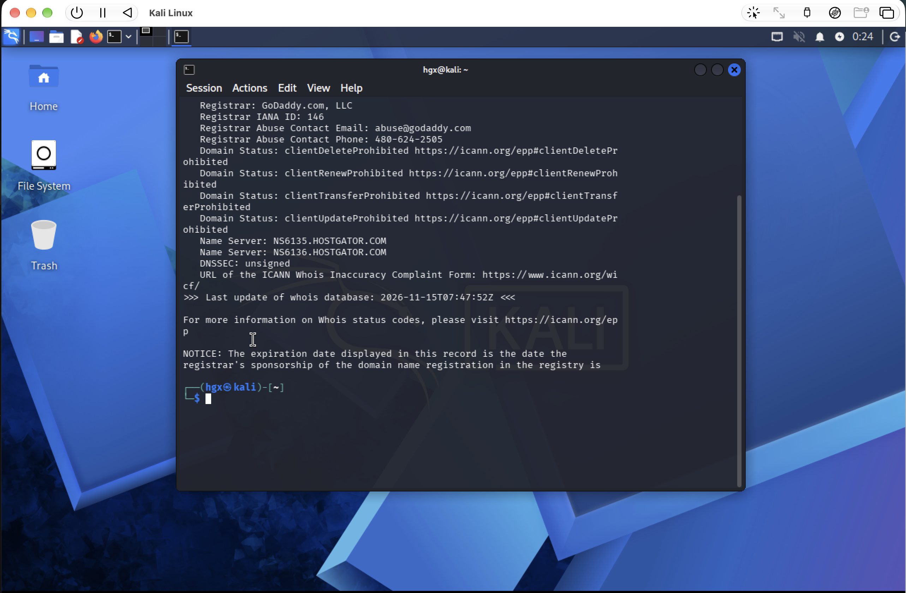
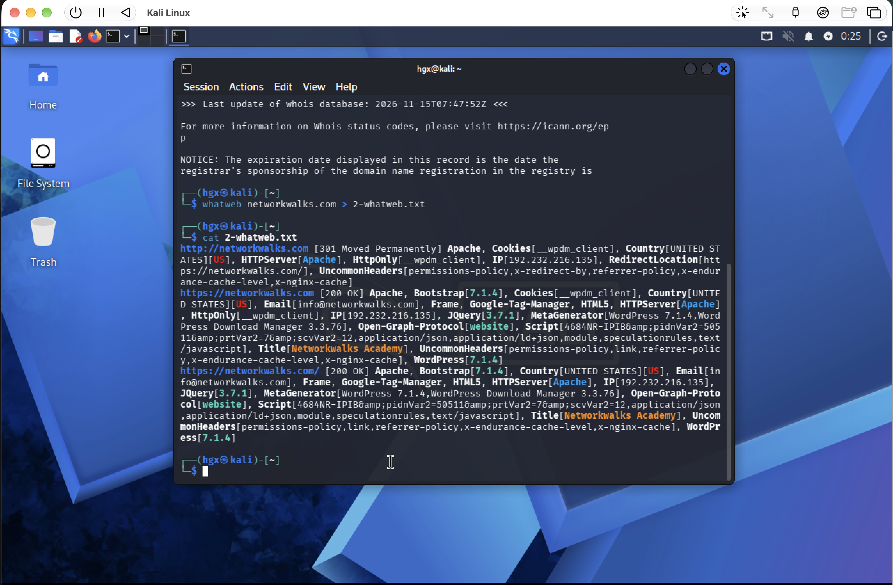
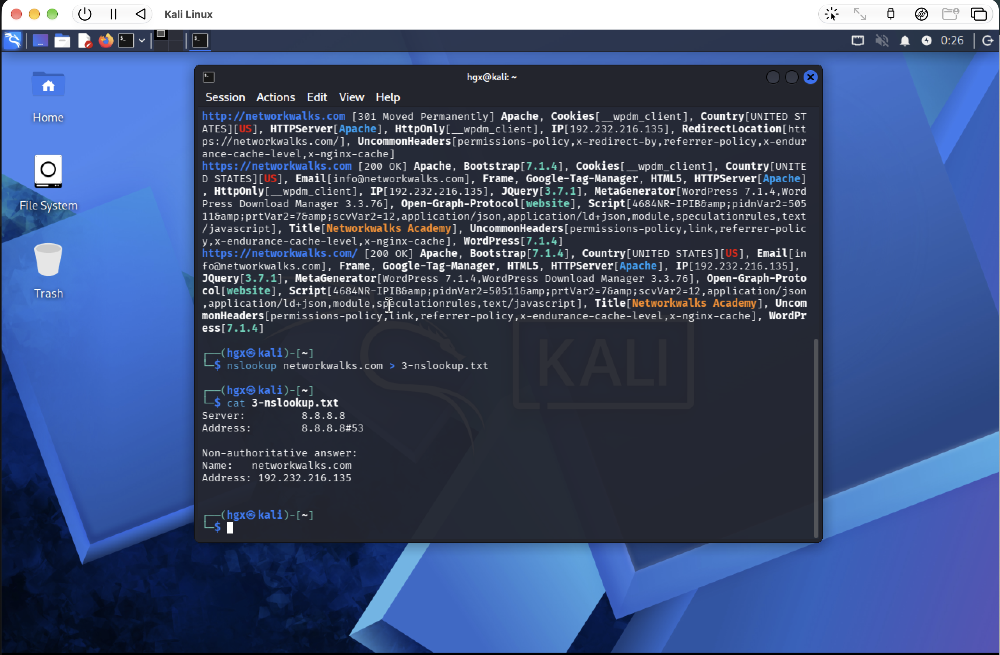
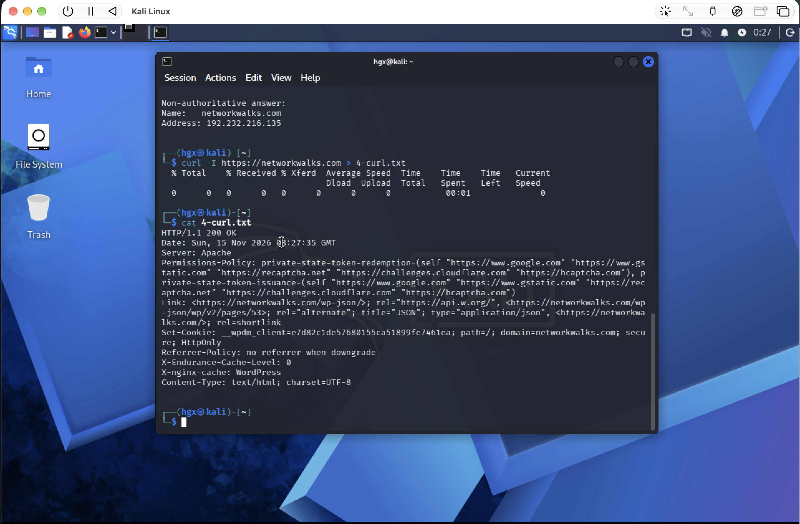
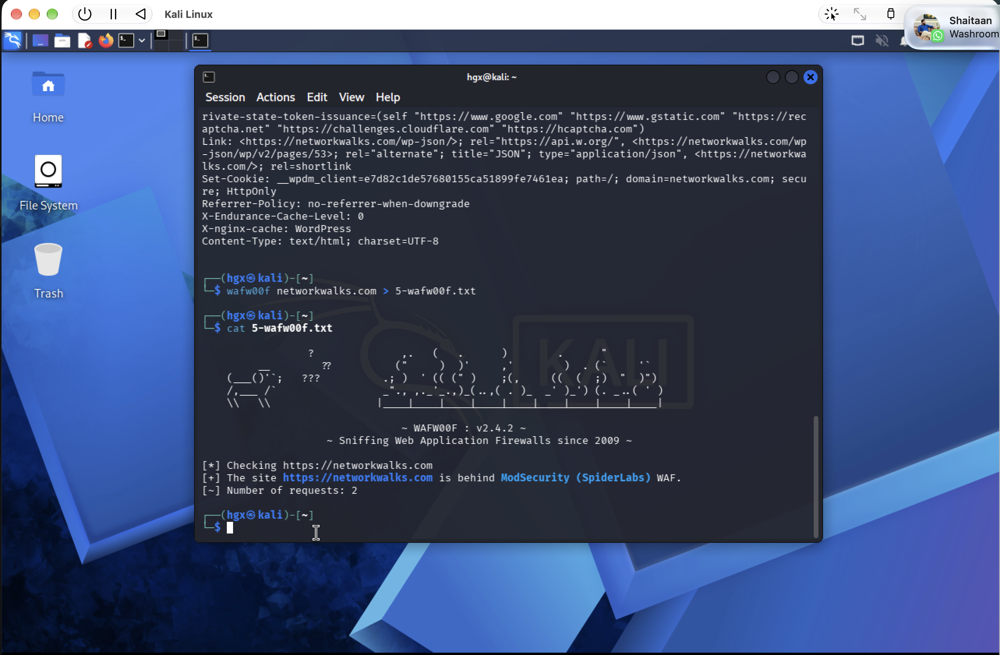
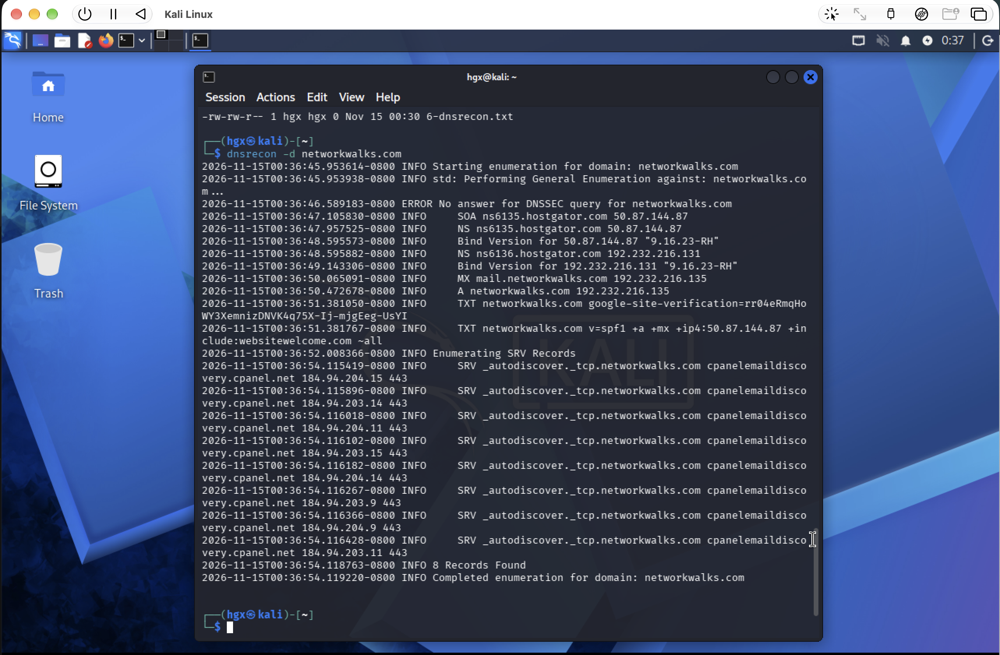
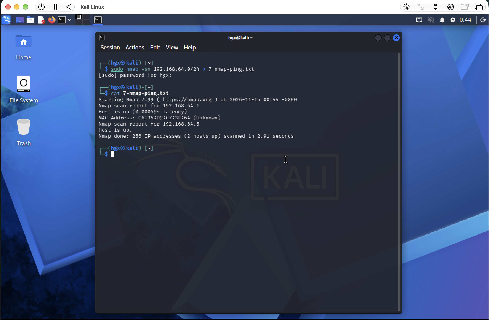
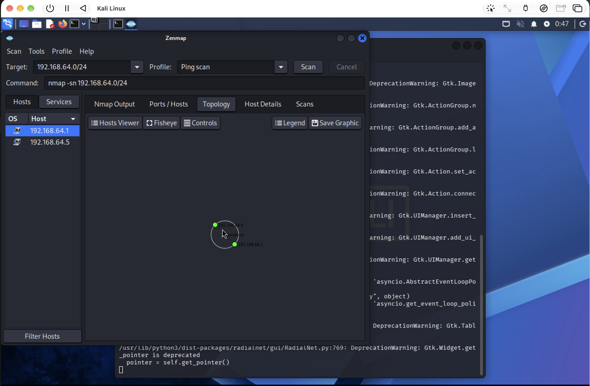

# My Week 2 Footprinting and Network Scanning

Week 2 project for Networkwalks Cybersecurity Internship, Batch B084M.
Modules: W2-PM1 Footprinting with multiple Kali tools, W2-PM5 Network Scanning with Zenmap, W2-PM-FINAL report.

Target 1: networkwalks.com, the internship's own site.
Target 2: my own lab network 192.168.64.0/24, Kali Linux on UTM, MacBook Air M2.

## PM1 - Footprinting networkwalks.com

Six Kali tools, run on 15 November 2026.

- whois: Registrar GoDaddy.com, LLC. Domain created 2019-11-06, expires 2027-11-06. Name servers NS6135.HOSTGATOR.COM and NS6136.HOSTGATOR.COM. Registrant private. DNSSEC unsigned.
- whatweb: Apache, WordPress 7.1.4, WordPress Download Manager 3.3.76, Bootstrap 7.1.4, jQuery 3.7.1. IP 192.232.216.135. Email info@networkwalks.com.
- nslookup: networkwalks.com resolves to 192.232.216.135.
- curl -I: HTTP 200 OK, Server Apache, WordPress REST API link /wp-json/ in headers.
- wafw00f: ModSecurity (SpiderLabs) WAF.
- dnsrecon: SOA ns6135.hostgator.com, Bind 9.16.23-RH, MX mail.networkwalks.com, SPF record, SRV cPanel records, 8 records found.

Problem faced: the first dnsrecon run saved an empty file, because dnsrecon writes its log to stderr. Fixed with `dnsrecon -d networkwalks.com > 6-dnsrecon.txt 2>&1`.

## PM5 - Zenmap scan of 192.168.64.0/24

Ping scan run in Kali on 15 November 2026 with `sudo nmap -sn 192.168.64.0/24`, the command-line equivalent of a Zenmap Ping Scan.

Result: 256 addresses scanned in 2.91 seconds, 2 hosts up:
- 192.168.64.1, gateway, MAC C6:35:D9:C7:3F:64
- 192.168.64.5, the Kali machine itself

The RedMind victim VM 192.168.64.6 was not running during the scan. Scan was on the lab network only, never on the home WiFi.

## Report

See week2-report.md for the full PM-FINAL report.

## outputs/

Text outputs of each command, transcribed from the Kali screenshots (the VirtFS shared folder was not mounted in Kali, so the files could not be copied off the VM directly; the screenshots in screenshots/ are the primary evidence and match these files). Topology PDF from Zenmap could not be transferred for the same reason; the Topology screenshot is in screenshots/8-zenmap-topology.png.
